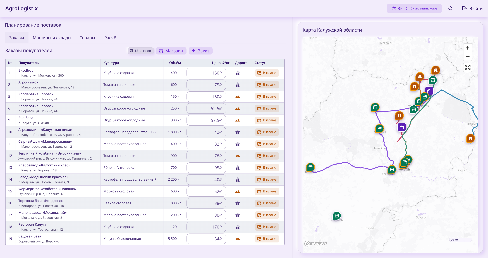
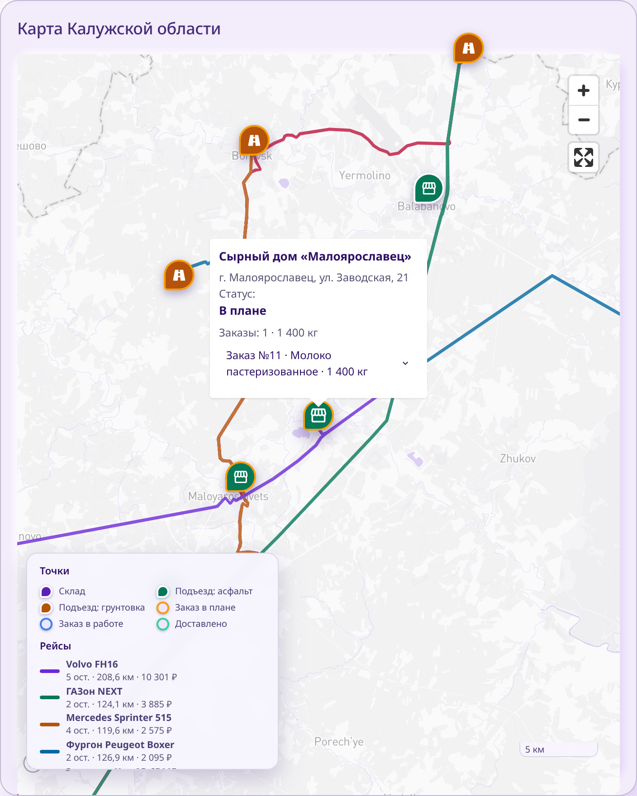
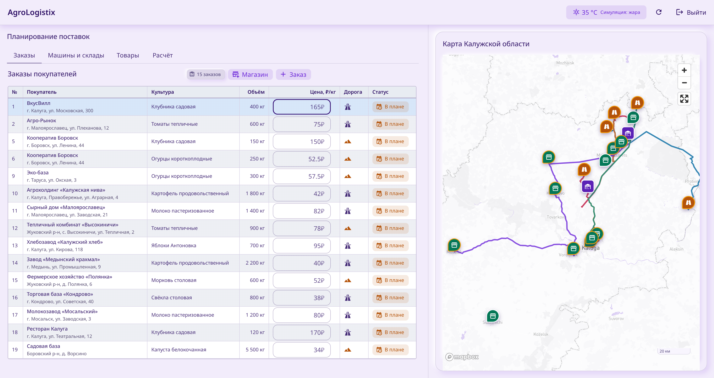
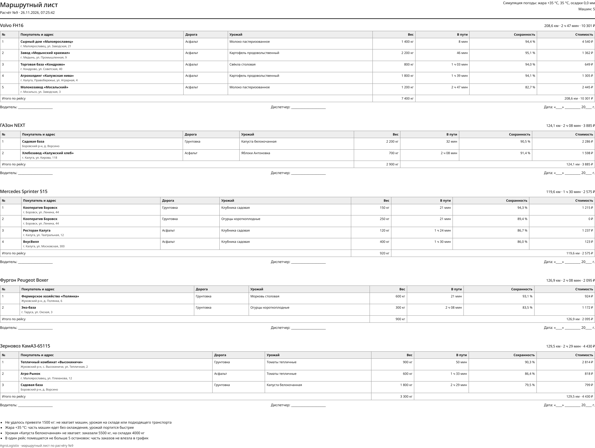
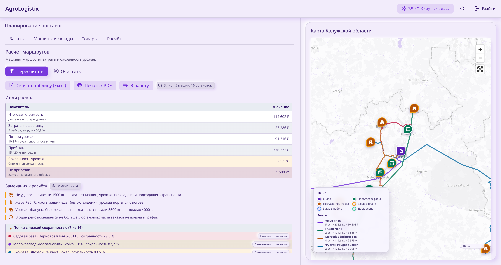

# AgroLogistix

ERP-система и гео-диспетчерская для агрологистики: единое рабочее место диспетчера, где заявки покупателей, остатки на складах, автопарк и погода превращаются в план рейсов с расчётом TCO, потерь урожая и сохранности к доставке.

Бизнес-задача — убрать ручную «сборку» маршрутов в Excel: система считает, какая машина, с какого склада и в каком порядке повезёт партию, сколько на этом заработаете и сколько урожая испортится в пути. Карта, таблицы и печатный маршрутный лист строятся из одного и того же плана, поэтому цифры в отчёте и в кабине водителя не расходятся.

## Визуальный обзор

**01 · Рабочее место диспетчера.** Слева — заявки с inline-редактированием цены, справа — карта с построенными рейсами: 15 заказов, 5 машин, 16 остановок в одном расчёте.



**02 · Картография.** Крупный план Mapbox GL: маркеры складов и покупателей, цветовая кодировка рейсов, попап с составом заявки клиента и легенда с километражем и стоимостью каждой машины.



**03 · Работа с данными без переходов по формам.** Цена за килограмм правится прямо в строке заявки: изменение уходит в API и сразу пересчитывает экономику плана.



**04 · Печатный маршрутный лист.** Тот же план в виде документа для печати и PDF: рейсы, адреса, вес, время в пути, сохранность и стоимость, поля для подписей водителя и диспетчера, а также замечания расчёта.



**05 · Вход по PIN.** Доступ к системе — шестизначный код диспетчера или администратора; отдельного лендинга нет, приложение целиком рабочее.


**06 · Расчёт и замечания солвера.** Итоговые метрики (TCO, потери, прибыль, сохранность, недовоз) и список проблем: дефицит остатков, жара без рефрижератора, лимит остановок в рейсе, точки с низкой сохранностью.



## Ключевые возможности

- **Единое рабочее пространство диспетчера.** Заявки, остатки по складам, автопарк и библиотека культур живут в одном экране: цена, количество и статус машины правятся inline, изменения сразу попадают в API, а состояние подтягивается автоматически — store остаётся единственным источником правды.
- **Алгоритмическая оптимизация рейсов.** MILP-ядро на `scipy` собирает план с учётом грузоподъёмности и оснащения машин (рефрижератор, изотермический кузов, допуск на грунтовку), TCO рейса, сроков годности партий и погоды из Open-Meteo (жара, дождь, замедление на грунтовке). После черновика идёт локальный поиск по реальной стоимости маршрута, а превышения лимитов по остановкам и времени рейса возвращаются как явные предупреждения, а не молчаливое урезание плана.
- **Интерактивная картография на Mapbox GL 3.** Склады и покупатели на карте, цветовая кодировка рейсов, совпадающая с таблицей плана, легенда с километражем и стоимостью, попапы с составом заявок. Без токена карта не ломает экран: включается graceful fallback со списком точек и причиной недоступности.
- **Документы и выгрузки.** Печатный маршрутный лист (`window.print`, отдельная print-раскладка) и выгрузка расчёта в XLSX через `openpyxl` — план уходит в работу без копипаста.

## Инженерные и архитектурные решения

- **Сквозная строгая типизация.** TypeScript в режиме `strict: true` и `noImplicitAny: true`, `0` использований `any`, `@ts-ignore` и `@ts-expect-error` по всей кодовой базе; типы проверяются `vue-tsc` на этапе сборки, а не «на глаз» в ревью. DTO бэкенда описаны Pydantic-схемами и повторяются в `shared/types/domain.ts`.
- **Отказоустойчивый транспортный слой.** `shared/api/httpClient.ts` — единый типизированный клиент: HTTP-ошибки маппятся в UX-уведомления, а mock-fallback включается **только для GET-запросов** в dev-режиме. Мутации (PATCH, назначение машины, расчёт плана, создание сущностей) никогда не подменяются моками — иначе диспетчер видел бы «сохранено» там, где данные не уехали на сервер.
- **Модульная архитектура и оптимизация бандла.** Слайсовая структура `sections/` + `shared/`, 7 изолированных Pinia setup-stores с узкой зоной ответственности (ERP, солвер, погода, назначения, ручное создание, авторизация, уведомления). Тяжёлые зависимости (`mapbox-gl`, `vuetify`) вынесены в отдельные чанки через `manualChunks` и tree-shaking, поэтому карта не тянется в бандл экрана входа.
- **Дисциплина качества и CI/CD.** Жёсткий лимит на размер модуля — `≤ 500` строк, проверяется скриптом `scripts/check_loc.sh` в CI; плюс `ruff` (lint + format), ESLint, Prettier, `vue-tsc` и **273 pytest-теста** бэкенда (математика свежести, солвер, API-контракты, лимиты рейсов). Пайплайн GitHub Actions проверяет всё это на каждый PR и деплоит на хост только зелёный `main`.

## Технологический стек

| Слой | Технологии |
| --- | --- |
| Frontend | Vue 3.5 (Composition API, `<script setup>`), TypeScript 5.6 `strict`, Vuetify 4, Pinia 2, Vue Router 4, Vite 6, SCSS, Mapbox GL 3 |
| Backend | Python 3.12, FastAPI, Pydantic v2 + pydantic-settings, SQLModel / SQLAlchemy 2 + SQLite (WAL), `scipy` (MILP + локальный поиск), `openpyxl`, `httpx`, Open-Meteo API |
| Инфраструктура и CI/CD | `uv` (lock-файлы), GitHub Actions, Nginx (standalone, TLS Let's Encrypt), `systemd`, ESLint + Prettier + `ruff`, pytest |

## Локальный запуск

Требования: Python 3.12, Node.js 22, `uv`.

```bash
# 1. Зависимости
uv sync --directory backend --extra dev
npm ci --prefix frontend

# 2. Конфигурация: секреты живут только в .env (файл в .gitignore)
cp .env.example .env                 # PIN, лимиты солвера, таймауты
cp .env.example backend/.env         # backend читает .env из своего каталога
printf 'VITE_MAPBOX_PUBLIC_TOKEN=pk.…\n' > frontend/.env   # публичный токен карты

# 3. Backend (http://127.0.0.1:8000)
uv run --directory backend uvicorn app.main:app \
  --app-dir backend --host 127.0.0.1 --port 8000 --reload

# 4. Frontend (http://127.0.0.1:5173, проксирует /api на backend)
npm run dev --prefix frontend
```

Локальные PIN по умолчанию — диспетчер `202601`, администратор `999999`; для любого публичного стенда их нужно переопределить в `.env`. Секретный `MAPBOX_SECRET_TOKEN` (серверные запросы к Directions) в репозиторий не попадает, публичный `VITE_MAPBOX_PUBLIC_TOKEN` — переменная этапа сборки и должен быть ограничен доменами в кабинете Mapbox.

Проверки локально — те же, что в CI:

```bash
uv run --directory backend --locked --extra dev ruff check .
uv run --directory backend --locked --extra dev pytest -q
npm run lint --prefix frontend && npm run type-check --prefix frontend
bash scripts/check_loc.sh
```

## Архитектура репозитория

```
backend/
  app/
    api/v1/        # auth, erp (+ создание), solver, weather, export, health
    core/          # настройки, БД, безопасность, rate-limit
    models/        # SQLModel-таблицы ERP и результатов расчёта
    schemas/       # Pydantic-контракты API
    services/      # солвер, свежесть урожая, матрица расстояний, XLSX, seed
  tests/           # pytest: математика, API, лимиты, регрессии
frontend/
  src/
    sections/      # вертикальные срезы: erp-dashboard, map-routing, pin-auth
    shared/        # api (httpClient), компоненты, типы, утилиты, стили
deploy/            # deploy.sh, sync-backend-env.sh, nginx, systemd-юнит
docs/              # screenshots/ — кадры интерфейса для README
scripts/           # check_loc.sh — контроль лимита 500 строк на модуль
```
