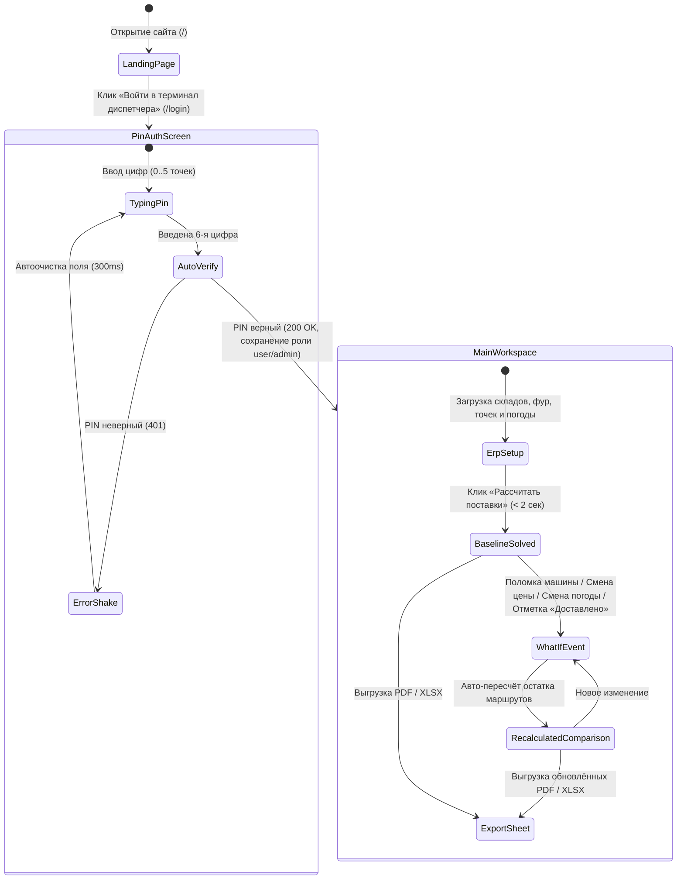
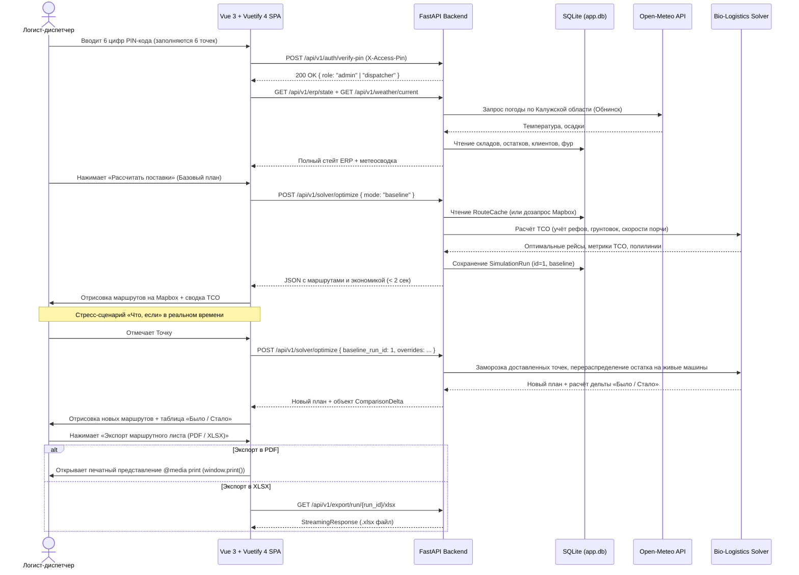

# User Flow & State Transitions

## 1. Диаграмма состояний экрана и сессии (State Diagram)

## 2. Пошаговая последовательность (Sequence Diagram: Расчёт и «Что, если»)

## 3. Обработка негативных пользовательских сценариев
1. **Неверный PIN-код:**
   * При вводе 6-й цифры кружки-индикаторы окрашиваются в цвет `error` (`#EF5350`), ряд точек выполняет горизонтальную CSS-анимацию `shake` (300 мс), после чего массив введённых символов автоматически очищается и фокус остаётся готовым к повторному набору с клавиатуры.
2. **Назначение еврофуры на грунтовку вручную / нехватка проходимых машин:**
   * Если все вездеходные среднетоннажники выведены из строя (`status = 'broken'`), а у клиента в селе подъезд `dirt`, солвер оставляет заявку этого клиента в статусе `Unmet Demand`, не назначая туда еврофуру, и выводит в блоке предупреждений: *«Точка [Название] недоступна: требуется транспорт с допуском к грунтовым дорогам»*.
3. **Экстремальная жара без рефрижератора:**
   * Если логист включает пресет «Жара +35°C» и ломает все машины с рефрижераторами, система сравнивает потери от порчи клубники в обычном тентованном кузове со штрафом за недовоз и выбирает математически наименьший убыток, наглядно подсвечивая падение средней свежести в таблице «Было / Стало».
