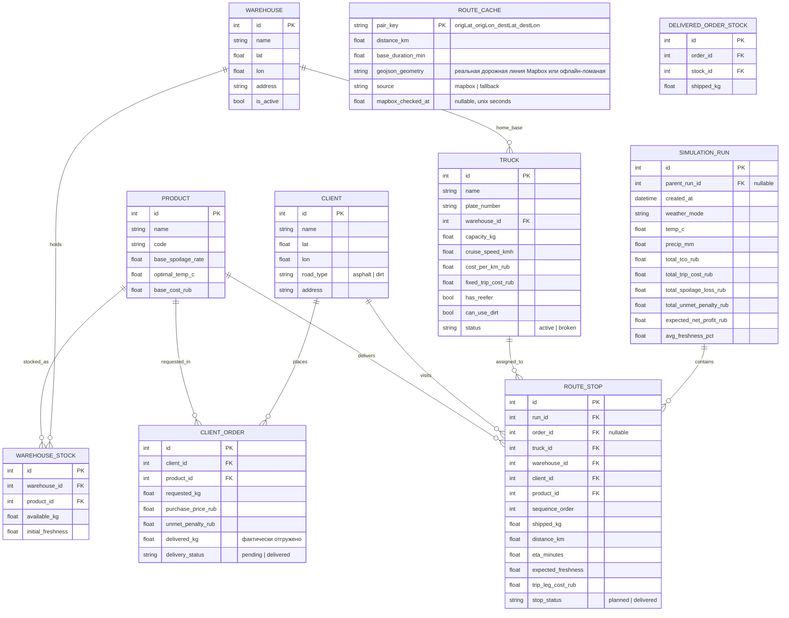

# Database Design (SQLite + SQLModel)

## 1. ER-Диаграмма (Mermaid)

## 2. Детальное описание таблиц и индексов

### 2.1. `warehouse` (Мульти-склады агрохолдинга)
* `id`: `INTEGER PRIMARY KEY`
* `name`: `VARCHAR(100) NOT NULL` (например: *«Хаб Обнинск-Северный»*, *«Склад Детчино-Агро»*)
* `lat`, `lon`: `FLOAT NOT NULL` (реальные координаты в Калужской области)
* `address`: `VARCHAR(255)`
* `is_active`: `BOOLEAN DEFAULT TRUE`

### 2.2. `product` (Справочник скоропорта)
* `id`: `INTEGER PRIMARY KEY`
* `code`: `VARCHAR(32) UNIQUE INDEX` (`strawberry`, `tomato`, `cucumber`)
* `name`: `VARCHAR(100) NOT NULL` (*Клубника садовая*, *Томаты тепличные*, *Огурцы короткоплодные*)
* `base_spoilage_rate`: `FLOAT NOT NULL` ($\lambda_p$ — доля потери свежести за 1 час при базовой температуре +20°C без рефа: клубника `0.08`, томаты `0.035`, огурцы `0.02`)
* `optimal_temp_c`: `FLOAT NOT NULL` (`+4.0` для клубники, `+10.0` для томатов/огурцов)
* `base_cost_rub`: `FLOAT NOT NULL` (себестоимость 1 кг на складе)

### 2.3. `warehouse_stock` (Остатки партий по складам)
* `id`: `INTEGER PRIMARY KEY`
* `warehouse_id`: `INTEGER REFERENCES warehouse(id) INDEX`
* `product_id`: `INTEGER REFERENCES product(id) INDEX`
* `available_kg`: `FLOAT NOT NULL CHECK (available_kg >= 0)`
* `initial_freshness`: `FLOAT NOT NULL DEFAULT 1.0` (от `0.5` до `1.0`)

Seed задаёт разные партии в пределах реальной холодовой цепочки: свежий сбор
из хаба Обнинск-Северный (`0.90–0.97`) и более старые партии в Детчино-Агро
(клубника `0.82`, огурцы `0.78`). Свежесть в точке доставки считается как
`initial_freshness · exp(-λ_p · t_факт · k_temp)`, поэтому остаточный срок
годности влияет на выбор склада и машины наравне с расстоянием.

### 2.4. `client` (B2B-покупатели Калужской области)
* `id`: `INTEGER PRIMARY KEY`
* `name`: `VARCHAR(120) NOT NULL` (например: *РЦ «ВкусВилл» Калуга*, *Агро-Рынок Малоярославец*, *Фермерский кооператив Боровск*, *Сеть «Пятёрочка» Балабаново*, *Эко-база Таруса*)
* `lat`, `lon`: `FLOAT NOT NULL`
* `road_type`: `VARCHAR(16) NOT NULL` (`asphalt` | `dirt`)
* `address`: `VARCHAR(255)`

### 2.5. `client_order` (Заявки покупателей)
* `id`: `INTEGER PRIMARY KEY`
* `client_id`: `INTEGER REFERENCES client(id) INDEX`
* `product_id`: `INTEGER REFERENCES product(id) INDEX`
* `requested_kg`: `FLOAT NOT NULL CHECK (requested_kg > 0)`
* `purchase_price_rub`: `FLOAT NOT NULL CHECK (purchase_price_rub > 0)` (закупочная цена клиента за 1 кг)
* `unmet_penalty_rub`: `FLOAT NOT NULL` (штраф за каждый недопоставленный кг)
* `delivered_kg`: `FLOAT NOT NULL DEFAULT 0` (сумма фактически отгружённых кг; остаточный спрос на пересчёте равен `requested_kg - delivered_kg`)
* `delivery_status`: `VARCHAR(16) DEFAULT 'pending'` (`pending` | `delivered` — при статусе `delivered` заявка считается уже закрытой при пересчётах «Что, если»; частично закрытая заявка остаётся `pending` с остаточным спросом)

### 2.6. `truck` (Автопарк)
* `id`: `INTEGER PRIMARY KEY`
* `name`: `VARCHAR(100) NOT NULL` (например: *Volvo FH16 Еврофура Реф*, *ГАЗон NEXT Реф-Вездеход*, *КАМАЗ Компас Тент*)
* `plate_number`: `VARCHAR(20) NOT NULL`
* `warehouse_id`: `INTEGER REFERENCES warehouse(id)` (склад базирования)
* `capacity_kg`: `FLOAT NOT NULL CHECK (capacity_kg > 0)`
* `cruise_speed_kmh`: `FLOAT NOT NULL CHECK (cruise_speed_kmh > 0)`
* `cost_per_km_rub`: `FLOAT NOT NULL`
* `fixed_trip_cost_rub`: `FLOAT NOT NULL`
* `has_reefer`: `BOOLEAN NOT NULL` (наличие холодильной установки)
* `can_use_dirt`: `BOOLEAN NOT NULL` (проходимость по грунтовке: у еврофуры `False`, у среднетоннажников `True`)
* `status`: `VARCHAR(16) DEFAULT 'active'` (`active` | `broken`)

### 2.7. `simulation_run` и `route_stop` (История расчётов и Маршрутные листы)
* Хранят полный слепок расчёта. Если `parent_run_id` заполнен, бэкенд автоматически формирует структуру `ComparisonDelta` (разница TCO, прибыли, свежести и недовоза между `parent_run_id` и текущим расчётом).
* `route_stop.order_id` связывает план с заявкой, чтобы `PATCH /erp/orders/{id}` знал, какие склады и объёмы списать при фиксации доставки.

### 2.8. `route_cache` (Кэш дорожных плеч)
* `pair_key`: `VARCHAR(128) PRIMARY KEY` (округлённые координаты `origLat_origLon_destLat_destLon`);
* `distance_km`, `base_duration_min`: метрики плеча от Mapbox Directions;
* `geojson_geometry`: сериализованный список точек `[lat, lon]` — реальная дорожная линия Mapbox или офлайн-ломаная (haversine×1.3) при недоступном API;
* `source`: `mapbox` для реального маршрута, `fallback` для офлайн-оценки. Записи со `source = 'fallback'` и `mapbox_checked_at IS NULL` остались от запусков без `MAPBOX_SECRET_TOKEN` и автоматически перезапрашиваются при первом же расчёте с токеном;
* `mapbox_checked_at`: unix-время последней попытки получить дорогу. Повторные попытки после неудачи ограничены `MAPBOX_RETRY_INTERVAL_SEC` (15 минут), чтобы дашборд не бил в API на каждом пересчёте;
* реальная дорожная геометрия отдаётся фронтенду в `RouteResponse.geometry`, поэтому линия на карте идёт по дорогам, а не по прямой.

### 2.9. `delivered_order_stock` (Журнал списания остатков)
* `id`: `INTEGER PRIMARY KEY`
* `order_id`: `INTEGER REFERENCES client_order(id) INDEX`
* `stock_id`: `INTEGER REFERENCES warehouse_stock(id) INDEX`
* `shipped_kg`: `FLOAT NOT NULL CHECK (shipped_kg >= 0)`
* Появляется при переводе заявки в `delivered`: фактические кг распределяются по складам последнего плана и вычитаются из `warehouse_stock.available_kg`. Записи удаляются с возвратом остатка, если заявку возвращают в `pending`.
